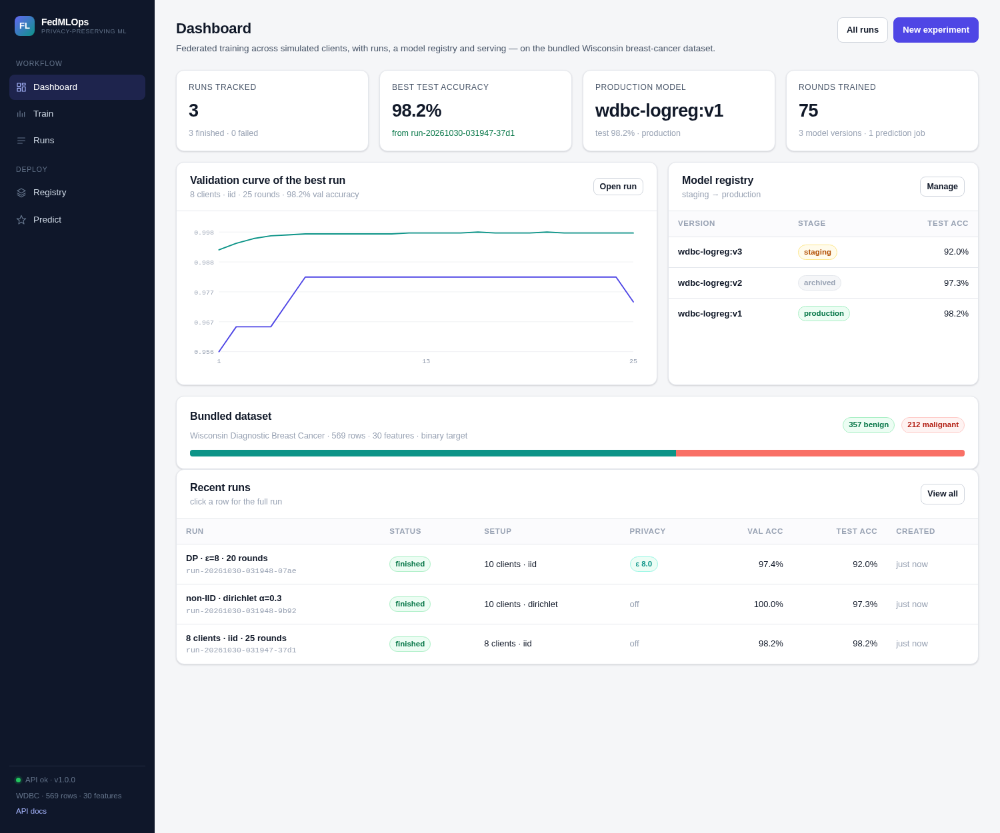
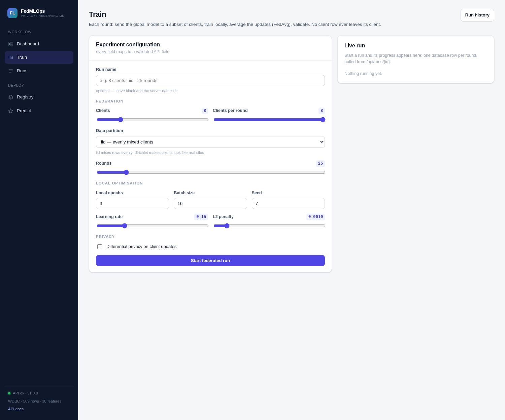
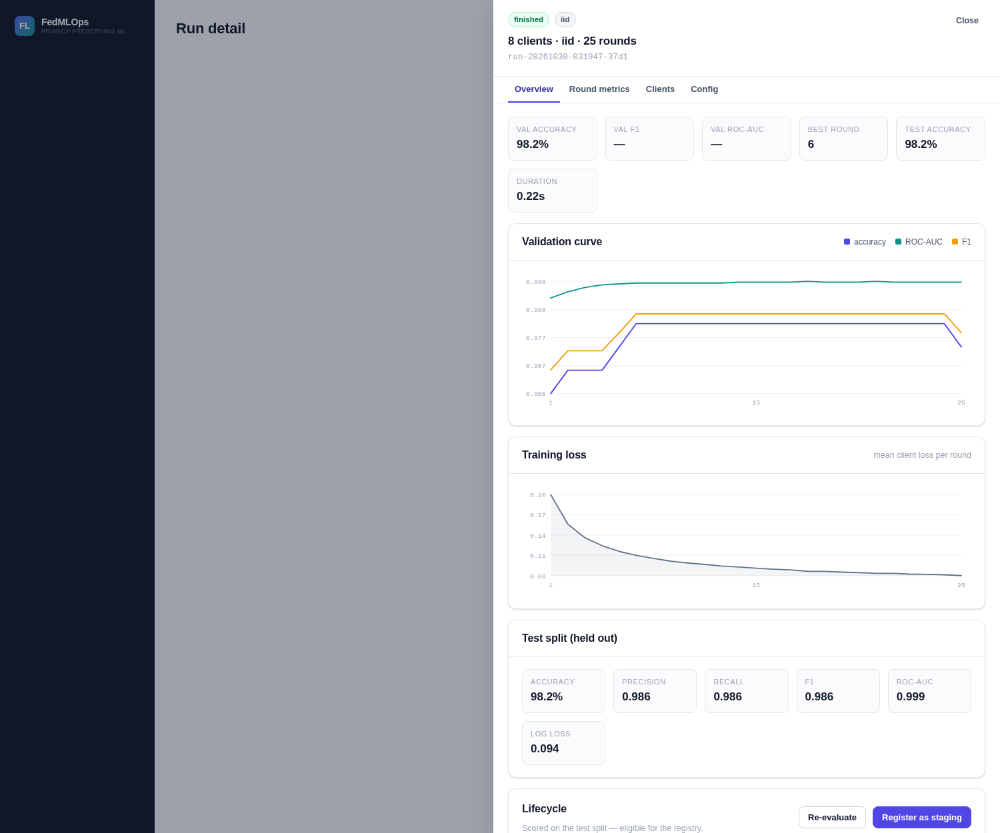
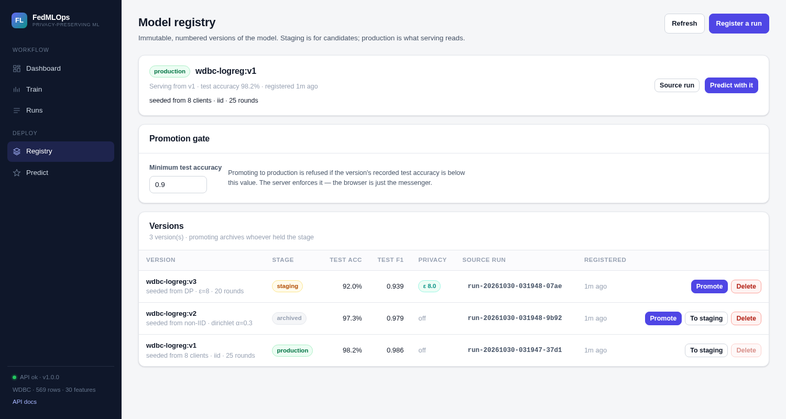
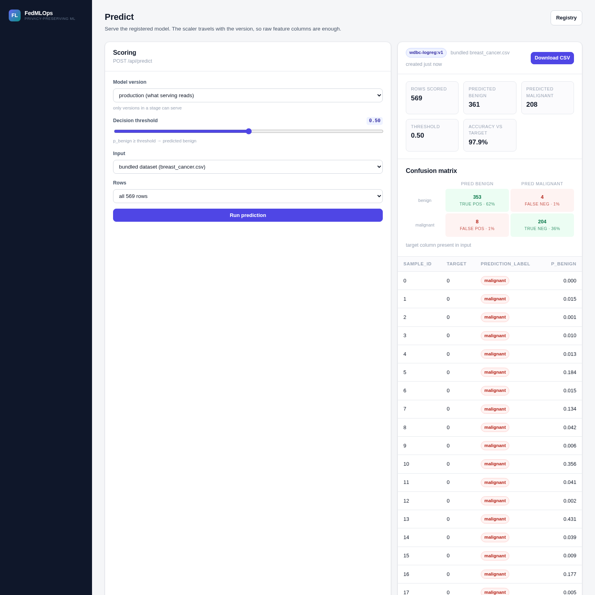

# Federated Learning with MLOps for Privacy-Preserving Systems

**An ML project: train a classifier without pooling the data.**

Hospitals hold the data and cannot hand it over — it is personal and regulated.
Federated learning moves the *model* instead of the data: each client trains
locally, sends only a parameter update, and a server averages the updates
(FedAvg) into a global model. This project implements that loop end to end and
puts a real MLOps workflow around it, so a model can be measured, versioned,
gated and served rather than left in a notebook.

- **ML core** — NumPy logistic regression, mini-batch SGD on each client,
  sample-weighted FedAvg, IID and Dirichlet (label-skewed) client partitioning,
  optional differential privacy (update clipping + Gaussian mechanism) with an
  ε/δ budget. No ML framework: every line that changes a parameter is readable.
- **Dataset** — Wisconsin Diagnostic Breast Cancer, bundled: 569 rows, 30
  features, binary benign/malignant.
- **MLOps** — every run tracked in a database with per-round metrics, immutable
  registry versions, promotion gated on a measured test score, serving from the
  production version.
- **Interface** — FastAPI backend, SQLite (SQLAlchemy), dependency-free
  JavaScript frontend, one command to run.

Read next: **[docs/MODEL_CARD.md](docs/MODEL_CARD.md)** (what the model is, how
well it works, where it must not be used) and
**[docs/EXPERIMENTS.md](docs/EXPERIMENTS.md)** (the algorithm, the knobs, how to
reproduce every number).

Team project, B.Tech AI&DS: Morla Jagadeesh, Bindu Priya Peddiboina.

---

## Quickstart

```bash
cd federated-mlops-web
python -m venv .venv
source .venv/bin/activate            # Windows: .venv\Scripts\activate
pip install -r requirements.txt -r requirements-dev.txt

cd backend
python -m app.seed --reset           # optional: fill the dashboard with 3 runs
python -m uvicorn app.main:app --reload --port 8000
```

Open <http://127.0.0.1:8000>. Interactive API docs: <http://127.0.0.1:8000/api/docs>.

Or with Docker (builds the image, serves on the same port, keeps the database on
the host):

```bash
docker compose up --build          # http://127.0.0.1:8000
docker compose --profile seed run seed   # optional: three example runs
```

### Terminal, no browser

The same pipeline is scriptable — same database, same services, same rules:

```bash
cd backend
python -m app.cli train --clients 8 --rounds 25                 # IID
python -m app.cli train --partition dirichlet --alpha 0.3       # label skew
python -m app.cli train --dp-epsilon 8 --rounds 20              # differential privacy
python -m app.cli evaluate --run <run-id>
python -m app.cli register --run <run-id>
python -m app.cli promote --version-id 1 --min-accuracy 0.9     # gated
python -m app.cli predict --limit 100
python -m app.cli list-runs ; python -m app.cli list-models
```

Training prints one line per round (loss, validation accuracy, ε if privacy is
on), which is what you want in a terminal and in CI.

## VS Code

Open the folder (`File > Open Folder`), then:

1. **Select the interpreter** — `Ctrl+Shift+P` → *Python: Select Interpreter* →
   `.venv/bin/python`. VS Code picks up `.vscode/settings.json` automatically.
2. **F5** → choose *Run API + UI (uvicorn --reload)*. Other launch configs:
   *Seed demo database*, *Pytest (all tests)*.
3. **Terminal → Run Task** has the same commands as tasks:
   install · seed · run server · run tests · reset database · health check.
4. The Testing panel finds the tests (pytest is preconfigured in settings).
5. `api.http` contains ready-to-send requests if you install the REST Client
   extension (recommended in `.vscode/extensions.json`).

## What is in the app

| Page | What it does |
|---|---|
| **Dashboard** | KPIs (runs, best test accuracy, production version, rounds trained), the best run's validation curve, registry snapshot, dataset class balance, recent runs |
| **Train** | Full experiment form — clients, clients-per-round, IID vs Dirichlet skew, rounds, local epochs, batch size, learning rate, L2, DP ε and clip norm. Live progress while it trains: progress bar, growing curve, last rounds |
| **Runs** | Every run with filters, plus per-row *Score* / *Register* / *Delete*; click a row for a drawer with overview, per-round metrics, client class balances and the exact config |
| **Registry** | Immutable versions with stage badges, promotion with an accuracy gate, one version per stage (promoting archives the previous holder), rollback by re-promoting |
| **Predict** | Score the bundled dataset or an uploaded CSV with any staged version; threshold slider, confusion matrix, preview table, downloadable CSV, history of scoring jobs |

### Screenshots

Dashboard — the pipeline at a glance:



Train — the federated and privacy knobs, with a live run panel:



Run detail drawer — curves, per-round metrics, client class balance, config:



Registry — versions, stages, promotion gate:



Predict — confusion matrix and downloadable predictions:



## Architecture

```
        browser (vanilla JS ES modules, no build step)
          │  fetch JSON / multipart
          ▼
    ┌─────────────────────────────────────────────┐
    │ FastAPI  backend/app/main.py                │
    │   routers/  runs · models · predict · meta   │
    │   services/ training · registry · prediction │
    │   SQLAlchemy ORM  ─────────────► SQLite      │
    │                    data/app.db               │
    └───────────────┬─────────────────────────────┘
                    │ imports
                    ▼
    backend/fedmlops/   pure NumPy core
      data · partition · model · trainer · privacy
```

The core library knows nothing about HTTP, FastAPI or SQL — that is what makes
it testable and what lets the training loop stay readable. The web layer adds
persistence, orchestration and the API.

### How a run flows

1. `POST /api/runs` validates the payload, inserts a **queued** row, and submits
   the job to a worker thread. The request returns immediately.
2. The worker loads the bundled CSV, splits it, partitions the training rows
   across clients, and runs the FedAvg loop. After **each round** it writes one
   `round_metrics` row and commits — that is the progress channel.
3. The browser polls `GET /api/runs/{id}`; the progress bar and curve come
   straight from those rows.
4. On finish the run is **finished** with a best-validation checkpoint stored as
   JSON. It has no test score yet.
5. `POST /api/runs/{id}/evaluate` scores it once on the untouched test split.
   **A run cannot be registered until it is scored.**
6. `POST /api/runs/{id}/register` copies the model into `model_versions` as
   `v1`, `v2`, … A version is immutable.
7. `POST /api/models/{id}/promote` moves the stage pointer, refusing if
   `min_accuracy` is set and unmet. The previous holder of that stage becomes
   `archived` — which is also how rollback works.
8. `POST /api/predict` reads the production version, applies the scaler stored
   with it, and writes predictions to `data/predictions/*.csv`.

### Database schema

| Table | Holds | Why it is a table |
|---|---|---|
| `runs` | one row per experiment: status, config JSON, best-round metrics, test metrics, DP settings | the experiment log; status is the progress channel |
| `round_metrics` | one row per round per run | makes the training curve queryable instead of a blob |
| `model_versions` | immutable artifact + stage, unique on `(name, version)` | promotion is an UPDATE, rollback is another UPDATE |
| `predictions` | each scoring job, its summary, preview and CSV path | an audit trail of what was served |

## API

| Method | Path | Purpose |
|---|---|---|
| GET | `/api/health` | liveness + version |
| GET | `/api/stats` | dashboard aggregates |
| GET | `/api/dataset/preview` | first rows + class balance |
| GET | `/api/config/defaults` | form defaults (same schema as the POST body) |
| POST | `/api/runs` | queue a federated run |
| GET | `/api/runs` | list runs (`status`, `scored_only`, `limit`) |
| GET | `/api/runs/{id}` | run detail + full history |
| POST | `/api/runs/{id}/evaluate` | score on the test split |
| POST | `/api/runs/{id}/register` | create a registry version |
| DELETE | `/api/runs/{id}` | delete a run (409 if a version points at it) |
| GET | `/api/models` | list versions (`name`, `stage`) |
| GET | `/api/models/production` | the serving version |
| POST | `/api/models/{id}/promote` | move stage, optional accuracy gate |
| DELETE | `/api/models/{id}` | delete a non-production version |
| POST | `/api/predict` | score the bundled dataset |
| POST | `/api/predict/upload` | score an uploaded CSV |
| GET | `/api/predictions` | scoring history |
| GET | `/api/predictions/{id}/download` | the predictions CSV |

## The ML method, briefly

Logistic regression with L2, trained by mini-batch SGD on each client, aggregated
by FedAvg. Per round: sample a subset of clients, send them the global
parameters, let each run `E` local epochs, collect `Δ_i = θ_local − θ_global`
(clipping and noising it if DP is on), then `θ ← θ + Σ (n_i/n)·Δ_i` and validate.
The registered artifact is the **best validation checkpoint**, not the last round.
Full pseudocode, the hyperparameter table and the reproduction commands are in
[docs/EXPERIMENTS.md](docs/EXPERIMENTS.md).

## Results (this dataset, one seed)

Test split of 113 rows:

| Run | Setup | Test accuracy | Test F1 |
|---|---|---|---|
| centralised reference | all rows pooled | 0.9911 | 0.9929 |
| default | 8 clients, IID, 25 rounds | 0.9823 | 0.9859 |
| non-IID | 10 clients, Dirichlet α=0.3 | 0.9735 | 0.9790 |
| DP ε≈8 | 10 clients, clipped + Gaussian noise | 0.9204 | 0.9390 |

The interesting column is the last one: privacy costs measurable accuracy, and
the app lets you move ε and watch the curve move.

## CI and Docker

`.github/workflows/tests.yml` runs on every push: `pytest` on Python 3.12, a CLI
smoke run (train → evaluate → register → predict), then a Docker build with the
tests executed inside the image and a health check against the running container.

The image is a single stage on `python:3.12-slim` that installs the runtime and
dev requirements, copies the backend, frontend, dataset and tests, and serves
`uvicorn app.main:app` on port 8000 with a `HEALTHCHECK` on `/api/health`.
`compose.yaml` mounts `./data` so the SQLite database and prediction CSVs survive
container restarts; a `seed` profile populates three example runs.

## Tests

```bash
python -m pytest -q        # 37 tests, ~7 s
```

They cover the API contract (validation rejections, lifecycle rules, 404/409
paths), the registry invariants (cannot register unscored, gate blocks a weak
model, promoting archives the previous holder, rollback), prediction paths
(bundled, upload, download, bad input), and the federated core itself (FedAvg is
a weighted mean, partitions cover every row, clipping bounds the norm, ε and σ
round-trip, the trainer improves and reports every round).

## What is deliberately simple

Named plainly, because a demo that hides its edges teaches the wrong lesson:

- **No authentication.** Every endpoint is open. Run it on localhost; do not put
  it on the public internet as-is.
- **Background work is a `ThreadPoolExecutor`**, not a task queue. Two workers,
  in-process, lost on restart. A real deployment wants Celery/RQ plus Redis.
- **SQLite with WAL.** Fine for a demo and for one machine; SQLite still has a
  single writer, so concurrent training jobs will serialise on writes.
- **Live progress is polling** (every 700 ms), not WebSockets or SSE.
- **Model parameters live in a database column.** Small enough here (31 floats);
  a real system stores artifacts in object storage and keeps a URI.
- **No secure aggregation.** The server sees individual client updates — the
  simulated clients are objects in one process, so there is no transport to
  protect. Differential privacy is the mitigation implemented; see
  `docs/PRIVACY.md` for what the ε number does and does not mean.
- **The scaler is fitted on pooled training data**, the one place the demo
  touches all rows at once. Noted in the stored artifact too.
- **Frontend is vanilla JS with no build step** — deliberate, so `git clone` +
  `pip install` + run is the whole setup. It has no router library, no state
  manager, and no offline mode.
- **Single dataset.** The 30-column WDBC CSV ships in `data/`; there is no
  upload-your-own-training-data path.

## Layout

```
federated-mlops-web/
  README.md
  requirements.txt · requirements-dev.txt
  api.http                     # sample requests (REST Client)
  .vscode/                     # launch, tasks, settings, extensions
  backend/
    app/
      main.py                  # FastAPI app factory, static mount, error mapping
      db.py models.py schemas.py deps.py seed.py
      routers/  runs.py models.py predict.py meta.py
      services/ training.py registry_service.py prediction_service.py serialize.py
    fedmlops/                  # pure NumPy core: data, partition, model, trainer, privacy
  frontend/
    index.html
    css/styles.css
    js/  app.js api.js ui.js charts.js  views/{dashboard,train,runs,registry,predict,runDetail}
  data/                        # bundled CSV, app.db (created on first run), predictions/
  docs/
    MODEL_CARD.md              # task, data, metrics, out-of-scope use, limits
    EXPERIMENTS.md             # algorithm, hyperparameters, results, reproduction
    PRIVACY.md                 # what the DP does and does not claim
    screenshots/
  tests/
```

## Data

Wisconsin Diagnostic Breast Cancer (WDBC), UCI ML Repository (Street, Wolberg &
Mangasarian, 1993), as distributed with scikit-learn: 569 rows, 30 numeric
features, `1 = benign`, `0 = malignant`. `data/make_dataset.py` regenerates the
CSV (it needs scikit-learn; the app does not).

## References

- McMahan et al., *Communication-Efficient Learning of Deep Networks from
  Decentralized Data*, AISTATS 2017 — FedAvg.
- Abadi et al., *Deep Learning with Differential Privacy*, CCS 2016 — clipping +
  Gaussian noise.
- Kairouz et al., *Advances and Open Problems in Federated Learning*, 2019.
